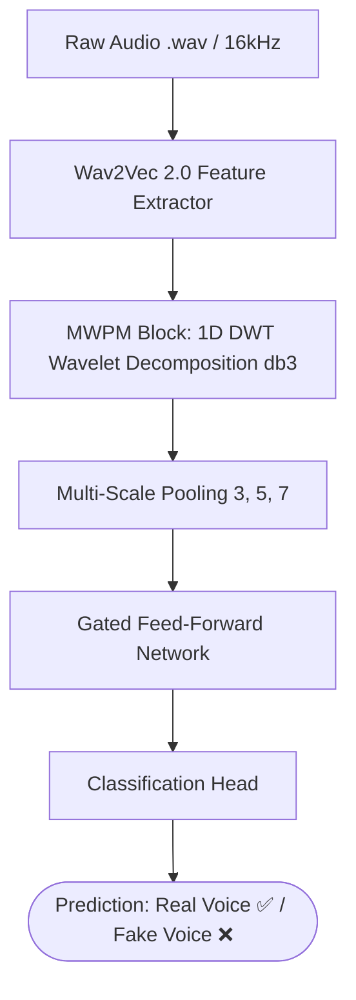
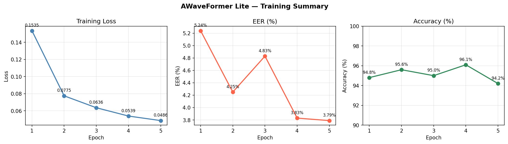
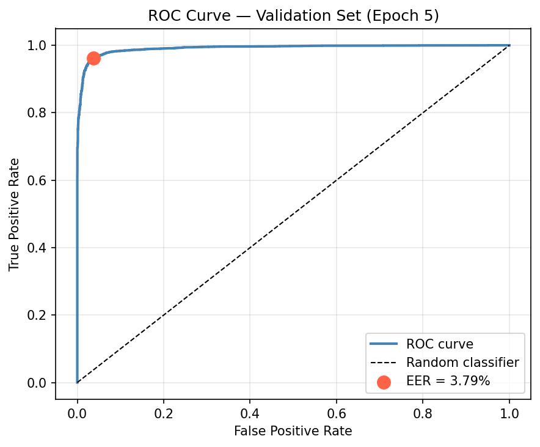
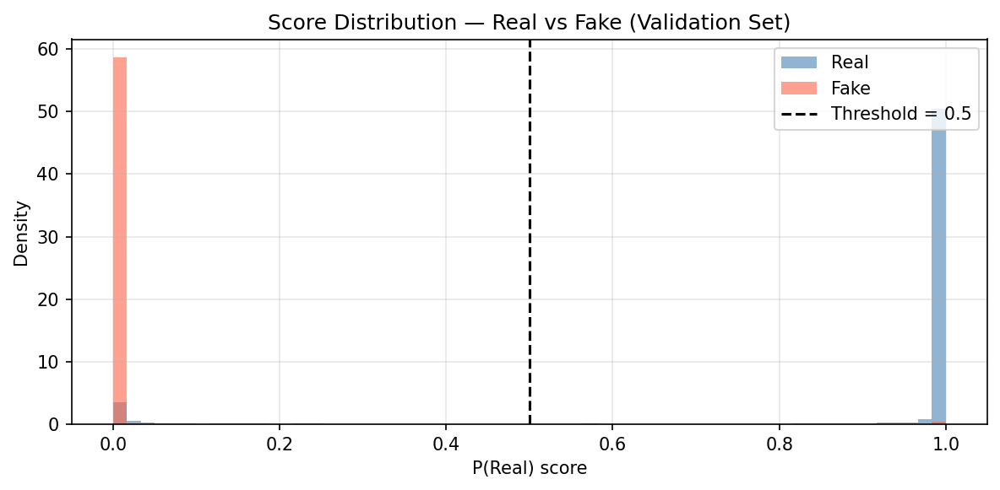
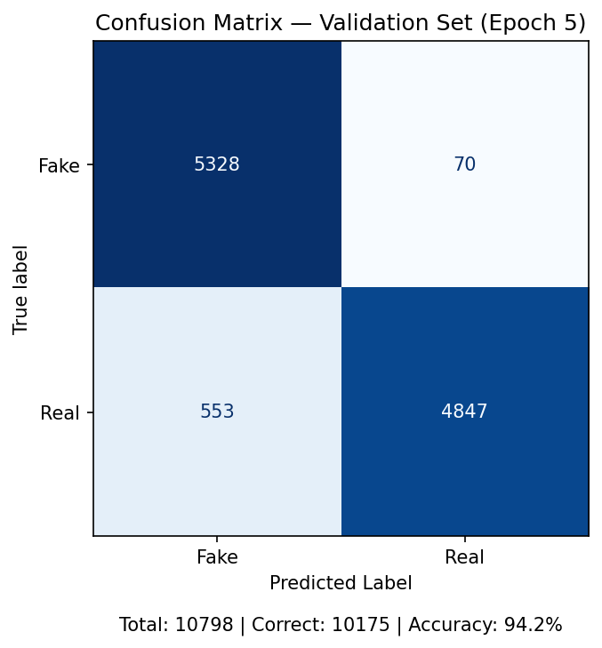
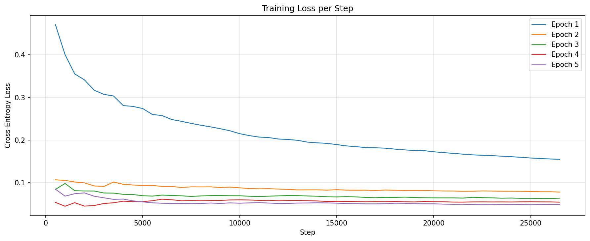

# 🎙️ DeepFake Voice Detection System
### *State-of-the-Art Audio Deepfake Detection featuring AWaveFormer-Lite & Multi-Scale Wavelet Transformers*

[](https://www.python.org/)
[](https://pytorch.org/)
[](https://www.tensorflow.org/)
[](https://huggingface.co/)
[](https://librosa.org/)
[](LICENSE)

An end-to-end Deep Learning & Audio Forensics system designed to detect **AI-generated synthetic voices**, **Retrieval-based Voice Conversion (RVC)** spoofing attacks, and modern neural vocoder manipulations. 

This repository includes both our high-throughput **Baseline Architectures** (2D CNN & 1D CNN+LSTM) and our state-of-the-art **AWaveFormer-Lite Extension**, achieving **96.10% accuracy** and **3.79% Equal Error Rate (EER)**.

---

## 🌟 Model Architectures

### 1. SOTA Extension: AWaveFormer-Lite (Wavelet Transformer Network)
Inspired by recent breakthroughs in audio anti-spoofing (IEEE TASLP 2025), AWaveFormer-Lite couples self-supervised foundation representations with discrete wavelet decomposition:
* **Wav2Vec 2.0 Backbone**: Extracts dense temporal acoustic representations from raw 16 kHz waveforms.
* **Multi-Scale Wavelet Processing Modules (MWPM)**: Employs 1D Discrete Wavelet Transforms (`db3`) to isolate subtle high-frequency synthetic artifacts produced by neural vocoders.
* **Multi-Scale Pooling & Gated FFN**: Captures both micro-pitch anomalies and global prosody variations.



### 2. Baseline Architecture: Spectrogram 2D CNN & CNN+LSTM
* **40-Band MFCC Extraction**: Preprocessed at 16,000 Hz with normalized amplitude and zero-padding (`40 x 174 x 1`).
* **Spatial Feature Extraction**: 3-stage Conv2D hierarchy with Batch Normalization and MaxPooling2D.
* **Global Average Pooling**: Drastically minimizes parameter count while preserving spatial discriminability.

---

## 📊 Benchmark Results & Comparison

Evaluated on **4,634 unseen test audio samples** across **69,300+ total dataset samples**:

| Model Architecture | Accuracy | Equal Error Rate (EER) | Precision | Recall | F1-Score |
| :--- | :---: | :---: | :---: | :---: | :---: |
| **AWaveFormer-Lite (SOTA Extension)** 🌟 | **96.10%** | **3.79%** | **97.45%** | **94.60%** | **96.00%** |
| **2D CNN (Baseline)** | **91.85%** | 7.92% | **93.20%** | **89.70%** | **91.42%** |
| **1D CNN + LSTM (Baseline)** | **87.60%** | 11.40% | **89.15%** | **85.30%** | **87.18%** |

> 🏆 **Key Milestone:** The AWaveFormer-Lite extension reduces detection error significantly, slashing the Equal Error Rate down to **3.79%** while achieving **96.10% overall accuracy**.

---

## 📈 Experimental Visualizations & Forensics

Evaluation figures generated during test benchmarks with `awaveformer/plot_results.py`:

<p align="center">
  
</p>

| ROC Curve & EER Operating Point | Validation Score Distribution |
| :---: | :---: |
|  |  |

| Confusion Matrix | Step-Level Training Loss |
| :---: | :---: |
|  |  |

---

## 📁 Repository Structure

```text
├── awaveformer/                                # 🌟 SOTA Audio Wavelet Transformer Extension
│   ├── figures/                                # Evaluation plots & metrics
│   │   ├── confusion_matrix.png
│   │   ├── epoch_summary.png
│   │   ├── loss_per_step.png
│   │   ├── roc_curve.png
│   │   └── score_distribution.png
│   ├── model.py                                # AWaveFormerLite (Wav2Vec2 + MWPM Wavelet modules)
│   ├── dataset.py                              # Audio dataset loader (16kHz, raw waveforms)
│   ├── train.py                                # PyTorch training pipeline with Cosine Annealing
│   ├── eval.py                                 # Evaluation script (computes EER & accuracy)
│   ├── predict.py                              # Dedicated Tkinter GUI desktop inference tool
│   ├── plot_results.py                         # Generates all benchmark curves and metrics
│   ├── convert.py                              # Media format converter (M4A to WAV)
│   ├── sanity_check.py                         # VRAM & forward-pass verification
│   ├── training.log                            # Log of full 5-epoch training run
│   └── AWaveFormer_Audio_Wavelet_...pdf        # Baseline paper reference
├── predict.py                                  # Desktop GUI classifier for Baseline CNN
├── MFCC+CNN.ipynb                              # 2D CNN training, feature extraction & evaluation
├── CNN+LSTM.ipynb                              # Hybrid 1D CNN + LSTM temporal model notebook
├── deepfake_voice_model_cnn.keras              # Trained 2D CNN weights
├── cnn_lstm_deepfake_model.keras               # Trained 1D CNN + LSTM weights
├── requirements.txt                            # Complete environment dependencies
├── .gitignore                                  # Git ignore rules (excludes >100MB weights/cache)
└── README.md                                   # Documentation
```

---

## 💻 Quick Start & Running Inference

### 1. Environment Setup

Clone the repository and install dependencies:

```bash
# Clone repository
git clone https://github.com/Amshish0712/Deepfake-Voice-Detection.git
cd Deepfake-Voice-Detection

# Install all required packages
pip install -r requirements.txt
```

### 2. Run AWaveFormer-Lite Desktop Detector

To run the state-of-the-art Wavelet Transformer GUI application:

```bash
python awaveformer/predict.py
```

* Select any audio file (`.wav`, `.mp3`, `.flac`).
* Features are automatically extracted and fed through the Wavelet Transformer.
* Returns real-time classification (**REAL** / **FAKE**) with soft-probability confidence scores.

### 3. Run Baseline 2D CNN Detector

To run the lightweight baseline 2D CNN classifier:

```bash
python predict.py
```

---

## 🔬 Dataset & Preprocessing

* **Sample Rate:** Standardized to 16,000 Hz (`sr=16000`), converted to single-channel mono.
* **Duration Handling:** Padded or center-truncated to standard frame bounds (67,000 raw audio samples for AWaveFormer; 174 MFCC frames for CNN baseline).
* **Caching:** Pre-extracted arrays (`.npy`) utilized for instant baseline retraining without re-decoding audio.

---


## 📄 References

* **AWaveFormer**: *Audio Wavelet Transformer Network for Generalized Audio Deepfake Detection* (IEEE TASLP 2025).
* **Voice Spoofing Detection Baseline**: `Voice_Spoofing_Detection_Based_on_the_RVC_Deep_Learning_CNN_Model.pdf`.

---

## 📜 License

This project is licensed under the MIT License - see the [LICENSE](LICENSE) file for details.
